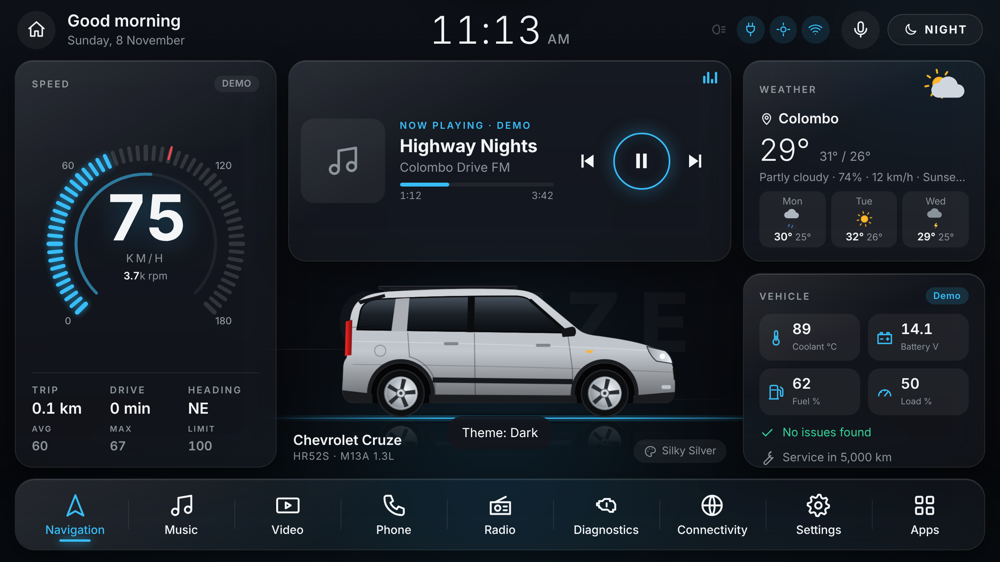
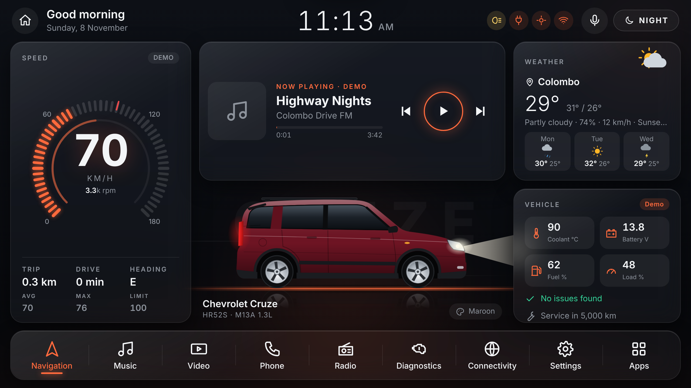

# Cruze Launcher

A lightweight Android home-screen launcher for the **Chevrolet Cruze HR52S (2001–2008)** head unit, with a live animated Cruze in the middle of the screen.




## Features
- ⚡ **Built for low-end head units** (2 GB RAM is fine). Pure Java + one WebView, no libraries. The APK is well under 1 MB. On low-RAM devices it switches to a *Lite* mode automatically (no blur, 25 fps cap).
- 🚗 **Live Cruze HR52S**: the wheels spin at your real speed, the body moves on the suspension, road lines and speed streaks scroll by, the brake lights flash when you slow down hard, and a light sheen moves across the paint.
- 🎨 **Paint colours**: Silver, Gray, Black, White, Maroon, Red, Blue, Green, Gold. The UI accent colour follows the paint.
- 🌗 **Light / Dark / Auto theme** in a glassy (crystal) style.
- 💡 **Headlights mode**: when your lights are on, the launcher turns on the car's headlights and beam and switches to dark. It detects lights from the head unit's illumination/night signal, the light sensor, or sunset time.
- 🏎️ **Speed gauge** with an RPM ring, speed-limit marker, overspeed beep, trip distance, drive time, heading, and average and max speed.
- 🔌 **OBD-II (ELM327 Bluetooth)**: speed, RPM, coolant, battery voltage, fuel, load, throttle and intake air. Reads and clears trouble codes, with descriptions. Warns about overheating, low battery or charging problems, and low fuel. Reconnects automatically when you start the car.
- 🎵 **Music card**: shows what's playing in Spotify, YouTube Music, Bluetooth audio and other apps, with play, pause, next and previous.
- 📻 **Live internet radio**: Sri Lankan stations, top stations worldwide, search, and favourites (from radio-browser.info).
- ⛅ **Weather card**: current weather and 3-day forecast from Open-Meteo (no API key). Uses GPS or a city you pick.
- 🔧 **Service reminder**: counts km since your last service.
- Dock: Navigation, Music, Video, Phone, Radio, Diagnostics, Connectivity, Settings, Apps. Also a voice assistant button and quick controls for volume, brightness and Bluetooth/Wi-Fi.

## Get the APK
Every push to `main` builds the APK with GitHub Actions (**Actions → Build APK → Artifacts → CruzeLauncher-apk**).
If you push a tag like `v1.0.0`, the APK is also attached to a GitHub Release.

Build it yourself (Android SDK + JDK 17):
```bash
./gradlew assembleRelease
# → app/build/outputs/apk/release/app-release.apk
```

## Install on the head unit
1. Copy the APK to the head unit and install it.
2. Press **Home** and choose **Cruze Launcher → Always**. You can also use Settings → *Set as home*.
3. Allow **Location** (for speed and weather) and **Nearby devices / Bluetooth** (for OBD).
4. Settings → **Allow media access**, so the music card can show and control songs.
5. OBD: pair your ELM327 adapter in Android Bluetooth settings (PIN is usually `1234` or `0000`). Then go to Diagnostics, pick the adapter and tap Connect.

> The 2004 HR52S uses Japanese OBD (JOBD / ISO 9141 / KWP2000). The launcher picks the protocol automatically. Some sensors, like fuel level, may not be reported by this car's ECU. Those tiles show `--`.

## Preview without a car
Open `app/src/main/assets/www/index.html` in Chrome. With no Android bridge it runs in demo mode, with simulated driving, OBD data and music.

## Project layout
```
app/src/main/assets/www/   UI: index.html, css/app.css, js/app.js, js/icons.js, js/dtc.js
app/src/main/java/...      MainActivity (WebView + GPS + light sensor + media + apps), ObdManager (ELM327), MediaListener
.github/workflows/build.yml  CI build
```
